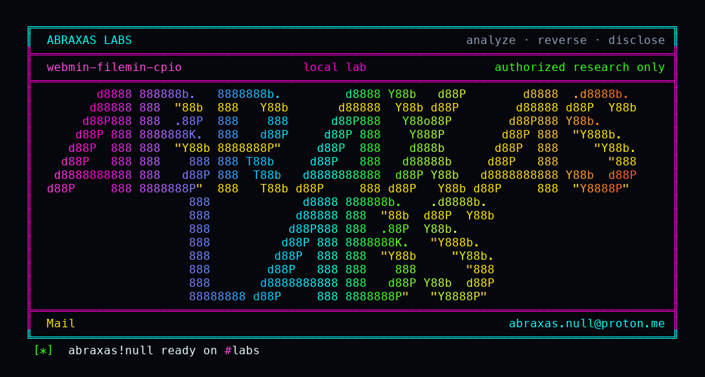

<p align="center">
  
</p>

# webmin-filemin-cpio

You give someone File Manager and one folder. They unpack an RPM. The archive sat in that folder. The files inside it did not.

Webmin File Manager is supposed to keep a signed-in user inside `allowed_paths`. When that jail is a real directory, and `work_as_root` is still on (the shipped default), extracting an RPM runs `rpm2cpio | cpio -idmv` with no `--no-absolute-filenames`. GNU cpio then writes member names that start with `/` wherever those names point, as root. This is not the default `$HOME` ACL, which Webmin already expands to the whole disk. It is a user who was fenced, unpacking an archive that looks like it belongs in the fence.

I pinned Webmin **2.670**. `extract.cgi` checks the RPM path. It never looks at the cpio members. I built a tiny RPM whose payload is one file named `/tmp/WEBMIN-H10-CPIO-WRITE`. After the File Manager extract, that path existed outside `/lab/jail`.

**Class:** Path write
**Reach:** Remote (File Manager, `work_as_root`, real `allowed_paths` jail)

**Webmin** `2.670` (`3a2b2b86`) - Webmin

| | |
|---|---|
| ID | no CVE yet |
| Class | **Path write** |
| Reach | **Remote** (signed-in File Manager user; `work_as_root`; real `allowed_paths` jail; `rpm2cpio` on the host) |
| CWE | [CWE-22](https://cwe.mitre.org/data/definitions/22.html) |
| CVSS | **High: 8.8** `CVSS:3.1/AV:N/AC:L/PR:L/UI:N/S:U/C:H/I:H/A:H` |
| Product | [Webmin](https://github.com/webmin/webmin) |
| Affected | **2.670** (`3a2b2b8671c0669c129f5275b3dd1853106ae02b`) |
| Auth | signed-in File Manager user. Not anonymous. Not default `$HOME=/`. |
| License | [GNU Affero GPL v3.0](LICENSE) |
| Lab | `127.0.0.1:18430` only. Witness file write, not a shell. |

## What an attacker can do

Needs a Webmin login that already has File Manager, `work_as_root=1`, and `allowed_paths` set to a real directory that is not the whole disk. Needs `rpm2cpio` and `cpio` on the host (typical on RPM-based installs; Debian's hard Depends are tar and unzip, not `rpm2cpio`). Shared MIME info types `*.rpm` as `application/x-rpm`, which is the branch that pipes to cpio.

The write is as the miniserv user, which is root when `work_as_root` is on. The later `chown -R` in `extract_files` only covers the intended extract directory, so slipped files stay root-owned.

| Privilege | Method / sink | Recon / integrity / availability | Lab-proven or inferred |
|---|---|---|---|
| Write a file at an absolute cpio member path outside `allowed_paths` | GET [`/filemin/extract.cgi`](https://github.com/webmin/webmin/blob/2.670/filemin/extract.cgi) `path=` `file=h10.rpm` after upload; `rpm2cpio \| cpio -idmv` | Integrity (root file write) | Lab-proven. `/tmp/WEBMIN-H10-CPIO-WRITE` held `WEBMIN-H10-CPIO-WRITE` |
| Same write via extract-on-upload | POST [`/filemin/upload.cgi`](https://github.com/webmin/webmin/blob/2.670/filemin/upload.cgi) with `extract_uploaded`; [`extract_files`](https://github.com/webmin/webmin/blob/2.670/filemin/filemin-lib.pl) `cpio -idmv` | Integrity | Inferred. Same argv. Lab used the listing extract CGI |
| Overwrite any path root can create (cron, keys, miniserv.conf, a CGI under the Webmin root) | same sink, chosen member name | Integrity / availability | Inferred from GNU cpio absolute extract. Not this lab's oracle |
| Negative control: relative extract inside the jail | same RPM if the member were `h10/tmp/...` | n/a | Lab-proven. Fail token `relative-inside-jail` if that path exists |

**Stays closed on this leftover**

| Axis | Method / sink | Why it is closed |
|---|---|---|
| Integrity | Default File Manager ACL `allowed_paths=$HOME` | [`get_allowed_paths`](https://github.com/webmin/webmin/blob/2.670/filemin/filemin-lib.pl) expands a single `$HOME` or `$ROOT` for root to `/`. That install already has the whole disk. Not this bug. |
| Integrity | Ordinary upload of `/tmp/...` as the file name | [`validate_filename_path`](https://github.com/webmin/webmin/blob/2.670/filemin/filemin-lib.pl) checks the archive name and the `-C` directory. It does not read cpio members. |
| Integrity | `download.cgi` | Forces `application/x-download`. Does not take this MIME branch. |
| Integrity | GNU tar member names with `..` | `tar xfp` skips those names. Separate from this RPM/cpio path. |
| Integrity | unzip `../` | unzip 6.0 strips `../` unless `-:`, which this code never passes. |
| Integrity | Usermin / `safeacl` / `work_as_root` off | Process uid becomes the Unix user first. Same member write is only that uid. |
| Integrity | [CVE-2026-49103](https://www.cve.org/CVERecord?id=CVE-2026-49103) | `mailboxes/detachall.cgi` attachment filename, fixed before 2.640. Different module. |
| Integrity | File Manager search/chooser listing | Closed on 2.670. Listing is not extract. |
| Integrity | Unauthenticated extract | miniserv requires a session. |
| Integrity | Host RCE in this lab | Oracle is a witness file. No shell. |

A File Manager grant is not a shell module. The product's own policy treats fine-grained ACLs as the control. `allowed_paths` is that control. This extract skips it.

## How I found it

I read [`filemin/extract.cgi`](https://github.com/webmin/webmin/blob/2.670/filemin/extract.cgi) on tag **2.670**. The RPM branch is:

```perl
$cmd = "(rpm2cpio ".
        quotemeta($full).
        " | (cd ".quotemeta($path).
        "; cpio -idmv))";
```

`quotemeta` is on the archive path and the cwd. The payload names never enter Perl. GNU cpio's default is still to honor absolute members unless you pass `--no-absolute-filenames`.

Wrong turns, in order: treating default `$HOME=/` as this bug; chasing tar `..` and unzip `../`; mixing this with [CVE-2026-49103](https://www.cve.org/CVERecord?id=CVE-2026-49103); calling ordinary upload a miss when `validate_filename_path` already holds the file name.

## Lab

```bash
python3 webmin-filemin-cpio-Abraxas-Labs.py
```

or:

```bash
cd lab
./run.sh
```

Clones [webmin/webmin](https://github.com/webmin/webmin) tag [2.670](https://github.com/webmin/webmin/releases/tag/2.670) (`3a2b2b8671c0669c129f5275b3dd1853106ae02b`) into `lab/src`, builds `webmin-lab:2.670`, binds `127.0.0.1:18430`. Limited user `fileuser` has File Manager only. Jail `/lab/jail`. `work_as_root=1`. Uploads a lab RPM, GET extract. Target **only** loopback. Witness file write. Not a shell.

```text
IOC pin-version=2.670 image=webmin-lab:2.670 expect=2.670
IOC rpm2cpio-list rc=0 /tmp/WEBMIN-H10-CPIO-WRITE
IOC mime=application/x-rpm
IOC outside-file='WEBMIN-H10-CPIO-WRITE\n'
SUCCESS WEBMIN-H10-FILEMIN-CPIO extract.cgi absolute-cpio WEBMIN-H10-CPIO-WRITE
```

## The fix

Pass `--no-absolute-filenames` to `cpio`. Reject members whose names are absolute or contain `..` before extract. Keep the jail check on the archive name; add the same check to the payload names.

## References

- [github.com/webmin/webmin](https://github.com/webmin/webmin) tag [2.670](https://github.com/webmin/webmin/releases/tag/2.670) (`3a2b2b8671c0669c129f5275b3dd1853106ae02b`)
- [`filemin/extract.cgi`](https://github.com/webmin/webmin/blob/2.670/filemin/extract.cgi) (`extract.cgi:43-51`)
- [`filemin/filemin-lib.pl`](https://github.com/webmin/webmin/blob/2.670/filemin/filemin-lib.pl) `extract_files` (`filemin-lib.pl:1150-1176`), `validate_filename_path` (`:896-925`), `get_allowed_paths` (`:252-258`)
- [`filemin/defaultacl`](https://github.com/webmin/webmin/blob/2.670/filemin/defaultacl)
- Nearby (not this path): [CVE-2026-49103](https://www.cve.org/CVERecord?id=CVE-2026-49103) `mailboxes/detachall.cgi`
- [CWE-22](https://cwe.mitre.org/data/definitions/22.html)

## License

GNU Affero GPL v3.0. See [LICENSE](LICENSE). Loopback lab only. No warranty.

Abraxas Labs
abraxas.null@proton.me
